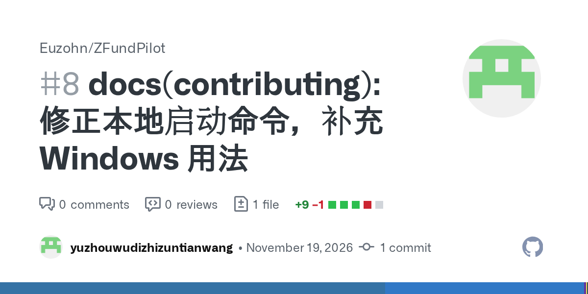
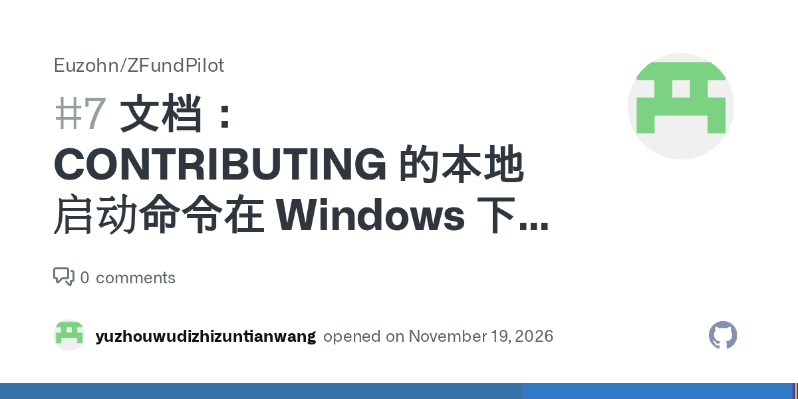

# 贸易服务结算与费用追溯（TST）

> Trade Settlement & Cost Traceability · 让每一笔费用都能说清"从哪来、该谁付、凭什么收"
> FDE 前置部署工程师实训项目 · 当前进度：**Stage 01 ✅ / Stage 02 ✅ / Stage 03 待启动**

---

## 1. 一句话说清这个项目

海川服贸（宁波）做出口一站式贸易服务（订舱、报关、拖车、仓储）。一次漏收事件暴露出真正的问题不是"员工不细心"，而是**费用没有单据级的追溯链**：船司的附加费写在邮件正文里、客户费率卡在共享盘上有 7 个"最终版"、账单靠 Excel 拼 40 行。本项目用 AI + 规则把"单票费用 → 来源单据 → 费率条款 → 承担方 → 凭证"这条链补起来，在开票前拦住漏收。

**触发事件**：2026-10-27 出口鹿特丹一票 40HQ，LSS/PSS/改配费共 ¥2,610 未计入客户账单，客户援引合同"7 日无异议"条款拒绝补收；单票毛利 8.2% → -1.4%，追溯耗时 3.5 小时。

---

## 2. 仓库信息

| 项 | 内容 |
|---|---|
| GitHub 仓库名 | `trade-settlement-trace-f25015243` |
| 可见性 | **public**（内容全部为实训构造数据，无真实客户信息，见 LICENSE 声明） |
| 默认分支 | `main` |
| 当前状态 | **已推送**（2026-11-05，main 分支，54 个文件） |
| 在线地址 | https://github.com/yuzhouwudizhizuntianwang/trade-settlement-trace-f25015243 |
| 推送方式 | `git push`（已配置 origin 与上游）；Token 不落盘，需要时重新生成 |

---

## 3. 仓库结构（对应白板要求）

```
trade-settlement-trace/                     ← GitHub: trade-settlement-trace-f25015243 (public)
├── README.md                  # 本文件：项目说明 + 交付物索引
├── LICENSE                    # MIT 协议（必须在根目录才会被识别）
├── .gitignore
├── docs/                      # ★ 老师要求的目录：成品报告 + 过程件
│   ├── 01_业务挖掘报告_f250118_f25015243_姚晔.md          ← 成品 ①
│   ├── 02_访谈记录_f250118_f25015243_姚晔.md              ← 成品 ②（md）
│   ├── 02_访谈记录_f250118_f25015243_姚晔.json            ← 成品 ②（json）
│   ├── 02_访谈记录_f250118_f25015243_姚晔.csv             ← 成品 ②（csv）
│   ├── 03_现场调研分析报告_f250118_f25015243_姚晔.md      ← 成品 ③
│   ├── 04-项目原有资料/               ← 成品 ④：原始资料 4 份（M-01~M-04）
│   ├── 05_现状流程图_…_姚晔.png       ← 成品 ⑤：现状流程图（PNG + SVG）
│   ├── 05_现状流程图_…_姚晔.svg
│   ├── 技术方案.md / 技术方案.docx     ← 智能体系统技术方案（含知识图谱）
│   ├── 技术案例.md                    ← BK2610-0187 端到端走查
│   ├── 提示词.md                      ← 6 组提示词 + 兜底话术
│   ├── 00-overview.md                 # 过程件：项目概览、四来源结论
│   ├── 01-opportunity-list.md         # 过程件：01-1 业务机会清单
│   ├── 02-baseline-metrics.md         # 过程件：01-2 指标基线与价值假设
│   ├── 03-charter-stakeholders.md     # 过程件：01-3 项目章程与利益相关者地图
│   ├── 04-interview-records.md        # 过程件：02-1 六角色访谈记录
│   ├── 07-requirements-spec.md        # 过程件：需求规格与追溯矩阵（REQ-01~10）
│   ├── 08-acceptance-criteria.md      # 过程件：验收标准清单（AC-01~10）
│   └── 09-stage-gates.md              # 过程件：阶段关卡评审记录
├── submit/                    # 提交平台的副本（文件名带班级/学号/姓名，与 docs/ 原件一致）
├── src/                       # 代码（阶段 05 落地，现为数据契约占位）
│   ├── README.md
│   ├── copilot/                       # 结算复核助手 Phase 1 骨架（可跑，24 项单测）
│   │   ├── app/core/{config,response,redline,security,llm}.py
│   │   ├── app/main.py                # /health /auth/login /auth/me /redline/preview /llm/ping
│   │   ├── config.yaml                # 六节配置，密钥走 ${ENV}
│   │   ├── tests/test_core_logic.py   # 24 条单测
│   │   └── verify.sh                  # 端到端验证（14 项断言）
│   └── settlement/
│       ├── __init__.py
│       └── models.py                  # 单票/费用行/费率卡/追溯链 数据契约
└── tools/
    ├── make_interview_exports.py      # 由同一份数据生成访谈 JSON + CSV（口径一致）
    └── push_github.sh                 # 一键推送（首次会提示输入 Token）
```

**docs/ 目录的两类文件**：

| 前缀 | 类型 | 用途 |
|---|---|---|
| `01_` / `02_` / `03_…_姚晔.md\|json\|csv` | **成品报告** | 提交平台 + GitHub 展示，老师直接看这几份 |
| `00-` `01-` `02-` `03-` `04-` `07-` `08-` `09-`（英文短横线命名） | **过程件** | 成品背后的拆分素材与证据链，可 diff、可追溯，答辩时用来解释「数字怎么来的」 |
| `04-项目原有资料/` | **原始资料** | M-01 任务书（docx）、M-02 制度节选（docx）、M-03 系统截图（png/svg）、M-04 三单对照（csv） |
| `05_现状流程图_*.png / .svg` | **图示** | 6 泳道 13 步现状流程，PNG 用于提交、SVG 可无限放大 |

> 白板约定的四件事已全部落地：`docs/` 放全部 `.md` 交付物、`README` 做索引与门面、`src/` 放代码、根目录 `MIT` 协议。

---

## 4. 提交清单（共 5 项，按白板要求）

| # | 提交内容 | 格式 | 文件 |
|---|---|---|---|
| ① | 业务挖掘报告 | md | `01_业务挖掘报告_f250118_f25015243_姚晔.md` |
| ② | 访谈记录报告 | **md + json + csv** | `02_访谈记录_f250118_f25015243_姚晔.md / .json / .csv` |
| ③ | 现场调研分析报告 | md | `03_现场调研分析报告_f250118_f25015243_姚晔.md` |
| ④ | 项目原有资料 | 4 份（Word / PNG / CSV） | `04-项目原有资料/`：任务书、制度节选、系统截图、三单对照 |
| ⑤ | 现状流程图 | PNG（+SVG） | `05_现状流程图_f250118_f25015243_姚晔.png` |

`submit/` 目录里是这 5 项的副本，命名与提交平台一致，可直接上传。

---

## 5. 智能体系统交付物（结算复核助手）

> **在线演示**：https://settlement-copilot.app.workbuddy.host/?sharecode=PFO3BIQLO2
> 演示账号 `chenlili / Demo#2026`（结算专员）、`zhouhui / Demo#2026`（复核人）、`zhangwei / Demo#2026`（单证，金额打码）
> 输入 `BK2610-0187` 即可复现 ¥2,610 漏收与四级追溯链。


| 文件 | 内容 | 状态 |
|---|---|---|
| `docs/技术方案.md` / `.docx` | 架构、选型理由、数据模型、**知识图谱 Schema**、红线实现、接口清单、里程碑 | ✅ |
| `docs/技术案例.md` | BK2610-0187 端到端走查（图谱 2 跳 → 差异 → 追溯链 → 人工确认） | ✅ |
| `docs/提示词.md` | 系统提示词 / 工具定义 / 检索改写 / 图谱抽取 / 差异归因 / 草稿生成 + 6 条兜底话术 | ✅ |
| `src/copilot/` | Phase 1 可运行骨架（26 项单测通过）+ `ollama/Modelfile` + 一键部署脚本 | ✅ |

**模型后端**：`provider: ollama`（`127.0.0.1:11434`，唯一主后端，不接任何外网大模型 API）；
系统提示词固化在 `src/copilot/ollama/Modelfile`，`scripts/setup_ollama.ps1` 一键部署；
未启动 Ollama 时按 `llm.fallback=rules` 降级为本地规则生成，并在输出中标注。

---

## 6. 开源实践（向第三方仓库提交 Issue 与 PR）

按实训要求，向**他人开源项目**提交了一个 Issue 与一个 Pull Request，均已真实提交、可点开核验：

| 类型 | 编号 | 链接 | 状态 |
|---|---|---|---|
| Issue | **#7** | https://github.com/Euzohn/ZFundPilot/issues/7 | open |
| Pull Request | **#8** | https://github.com/Euzohn/ZFundPilot/pull/8 | open，mergeable，1 file +9 −1 |

**目标仓库**：`Euzohn/ZFundPilot`（Python + FastAPI，MIT，★32）—— 所有者 `Euzohn`，**非本人仓库**。
**提交账号**：`yuzhouwudizhizuntianwang` ｜ **提交时间**：2026-11-19 10:22 UTC

**Issue #7**：指出 `CONTRIBUTING.md` 的启动命令 `PYTHONPATH=src uvicorn ...` 是 POSIX 语法，Windows 下会报错，且与 README 写法不一致。
**PR #8**：修复该问题——去掉 `PYTHONPATH` 前缀并补 Windows 写法，仅动 `CONTRIBUTING.md` 一个代码块（+9 −1）。

| Pull Request #8 | Issue #7 |
|---|---|
|  |  |

> 详细说明与核验方式见 [`docs/开源实践.md`](docs/开源实践.md)；图片为 GitHub 官方页面预览图。

---

## 7. 交付物索引

| 阶段 | 任务 | 交付物 | 过程件 | 成品报告（`docs/`） |
|---|---|---|---|---|
| 01 业务挖掘 | 1 识别业务机会 | 业务机会清单 | `docs/01-opportunity-list.md` | **01_业务挖掘报告**（第二章） |
| 01 业务挖掘 | 2 建立现状基线 | 指标基线与价值假设 | `docs/02-baseline-metrics.md` | 01（第三章） |
| 01 业务挖掘 | 3 确认立项与决策链 | 项目章程与利益相关者地图 | `docs/03-charter-stakeholders.md` | 01（第四章） |
| 02 现场调研 | 1 开展角色访谈 | 访谈记录与角色地图 | `docs/04-interview-records.md` | **02_访谈记录**（md / json / csv） |
| 02 现场调研 | 2 还原现状流程 | 现状流程图与异常路径 | `03_…_姚晔.md` 第二章 | **03_现场调研分析报告** |
| 02 现场调研 | 3 四来源收敛 | 四来源收敛表、证据台账 | `03_…_姚晔.md` 第三、四章 | 03（同上） |
| 03 需求定义 | 2 编写需求与边界 | 需求规格与追溯矩阵 | `docs/07-requirements-spec.md` | 后续阶段报告 |
| 03 需求定义 | 3 约定验收标准 | 验收清单与确认记录 | `docs/08-acceptance-criteria.md` | 后续阶段报告 |
| 02 现场调研 | 2 还原现状流程（图） | 现状流程图（AS-IS） | `docs/05_现状流程图_*.svg` | **05_现状流程图**（PNG/SVG） |
| — | 原始资料 | 任务书 / 制度 / 系统截图 / 样例单据 | `docs/04-项目原有资料/` | **04-项目原有资料** |
| 全局 | 阶段关卡 | 评审记录 | `docs/09-stage-gates.md` | — |

命名规则：`序号_文档名_班级_学号_姓名`，如 `01_业务挖掘报告_f250118_f25015243_姚晔.md`。过程件用英文短横线命名，两类文件一眼可分。

---

## 8. 核心指标：基线 → 目标

| 指标 | 口径（起点→终点） | 基线（2026 Q3） | 目标 | 数据来源 |
|---|---|---|---|---|
| 漏收率 | 漏收金额 ÷ 当期应收总额 | 1.80%（¥78.9 万 / ¥4,386 万） | ≤0.60% | 财务月结报告 + E-006 |
| 结算周期 | 提单签发日 → 客户账单发出日 | 中位 11.5 天，P90 19 天 | 中位 ≤6 天，P90 ≤9 天 | CargoWare 日志 + E-009 |
| 账单一次通过率 | 无异议账单 ÷ 发出账单 | 71.3%（904/1,268） | ≥90% | 客服台账 E-011 |
| 单笔差异追溯耗时 | 收到异议 → 给出书面归因 | 42 分钟/条 | ≤8 分钟 | 现场观察 E-012 |
| 对账差异条目 | 月度比对不一致费用行 | 812 条/季 | ≤240 条/季 | 差异台账 E-010 |
| 季末"待查"挂账 | 无法归因的挂账金额 | ¥120 万 | ≤¥30 万 | 财务 E-013 |

年化收益测算：漏收挽回 ¥210 万 + 人工节约 ¥40.5 万 ≈ **¥250 万/年**，投入 48 万，首年 ROI ≈ **4.2 : 1**。

---

## 9. 编号约定（跨文档唯一）

| 前缀 | 含义 | 示例 | 维护位置 |
|---|---|---|---|
| `E-` | 证据编号，采集到的原始事实 | `E-007` 费率卡 7 个版本截图 | `docs/03` 第四章 证据台账 |
| `M-` | 分歧/矛盾点编号 | `M-02` 结算周期口径分歧 | `docs/03` 第三章 3.3 |
| `V-` / `G-` | 待核实项 / 访谈缺口 | `V-06` 漏收构成分布 | `docs/03` 第五章 |
| `REQ-` | 需求编号，贯穿方案/构建/验收 | `REQ-03` 供应商账单解析比对 | `docs/07-requirements-spec.md` |
| `AC-` | 验收条目编号，对应 REQ | `AC-03` 解析字段准确率 | `docs/08-acceptance-criteria.md` |
| `X-` | 异常路径编号 | `X-01` 甩柜改配新增附加费 | `docs/03` 第二章 + `docs/05` 流程图 |

**规则**：证据栏只填本次真正采集到的事实编号；未采集到的一律写"待采集"，不许用印象值或他人案例替代。

---

## 10. 怎么读这个仓库

1. 只想看结论 → `docs/00-overview.md`（含四来源收敛结论与 7 项待核实）
2. 要评审阶段 01 → `docs/01_业务挖掘报告_*.md` + `docs/09-stage-gates.md`
3. 要评审阶段 02 → `docs/02_访谈记录_*`（md/json/csv）+ `docs/03_现场调研分析报告_*.md` + `docs/09-stage-gates.md`
4. 要进入开发 → `docs/07`（需求）+ `docs/08`（验收）+ `src/settlement/models.py`（数据契约）

---

## 11. 边界声明

- 本项目 **不含** 真实客户数据。所有企业名、人名、金额、单号均为实训场景构造，口径与方法遵循真实 FDE 流程。
- `docs/` 中所有"原话"来自实训角色访谈记录，金额与单号已做脱敏替换。
- 阶段 02 的报告只是**输入**，不自动通过关卡；关卡结论见 `docs/09-stage-gates.md`。

---

## 12. License

MIT © 2026 海川服贸 FDE 实训小组
